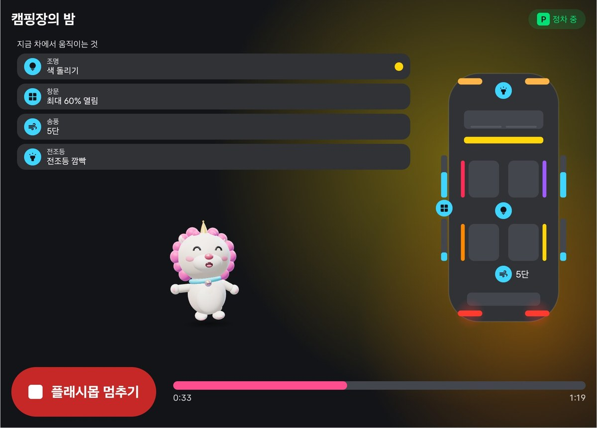
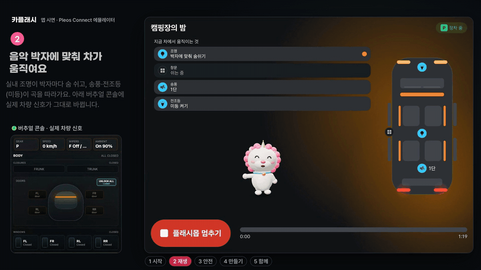
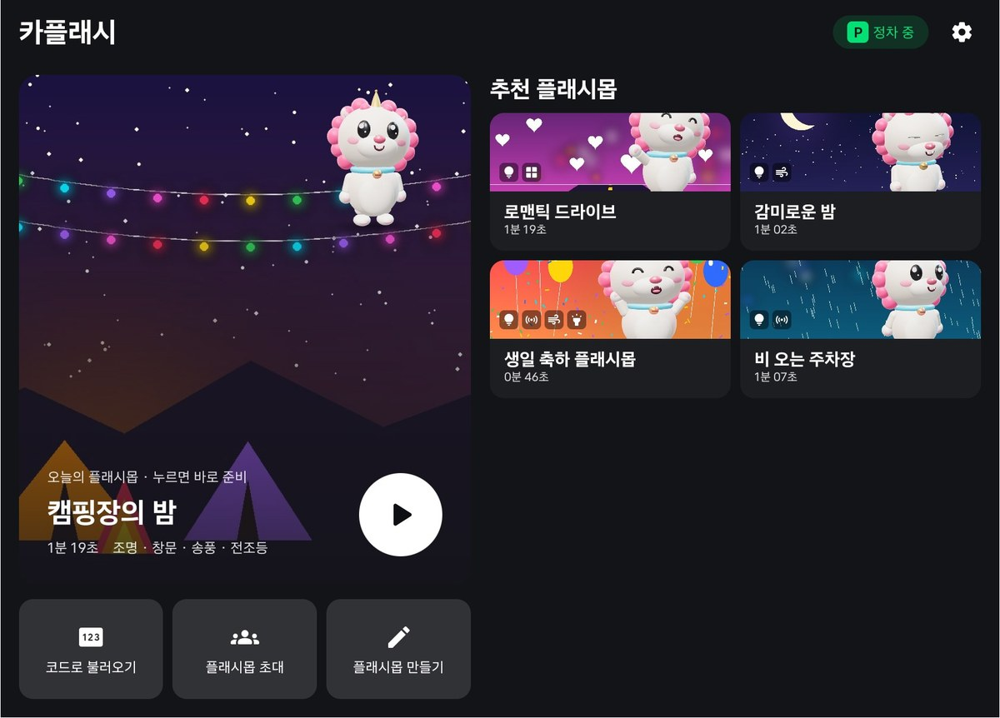
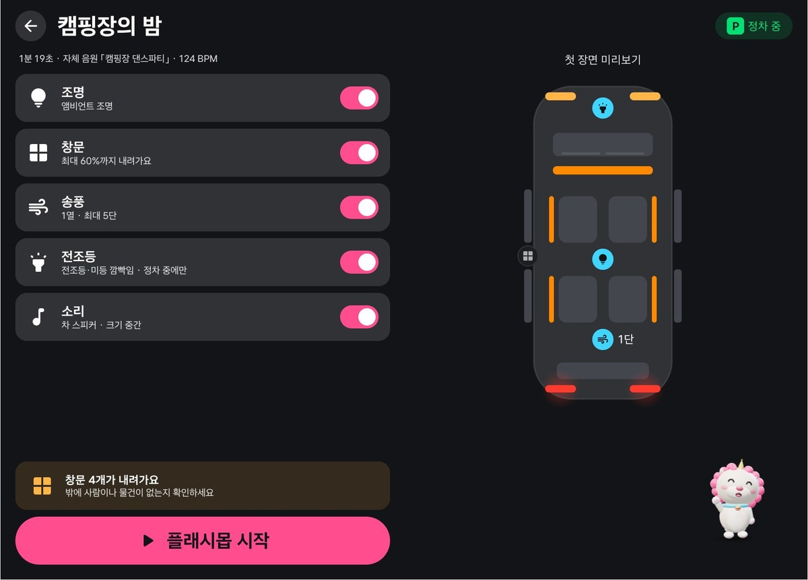
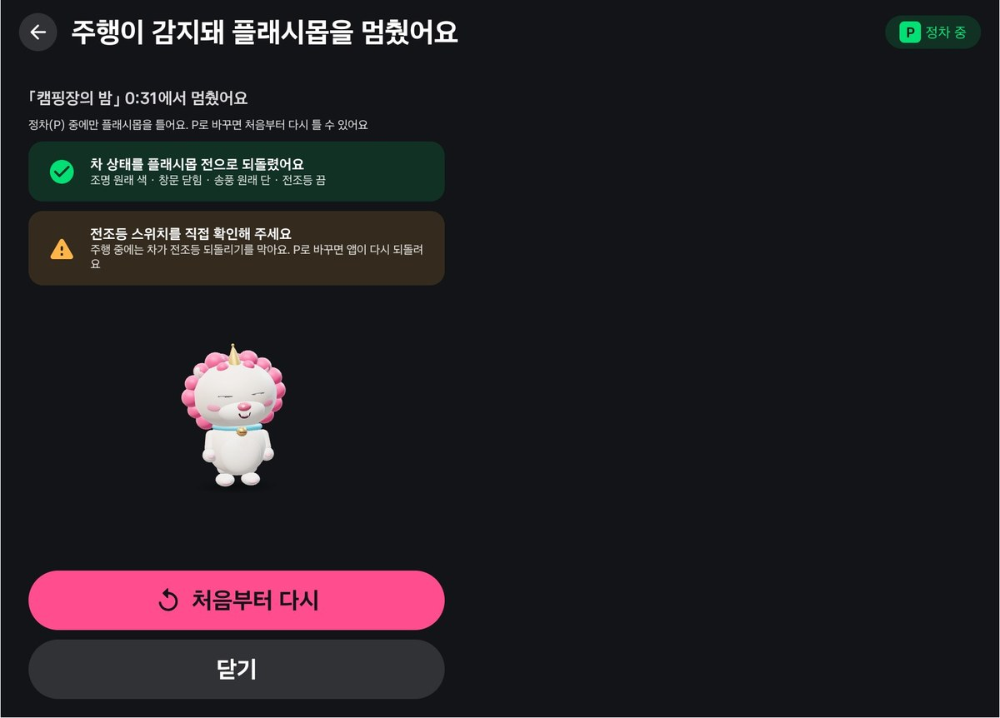
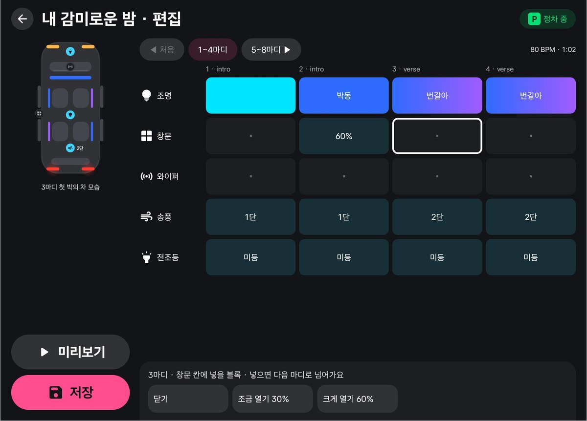
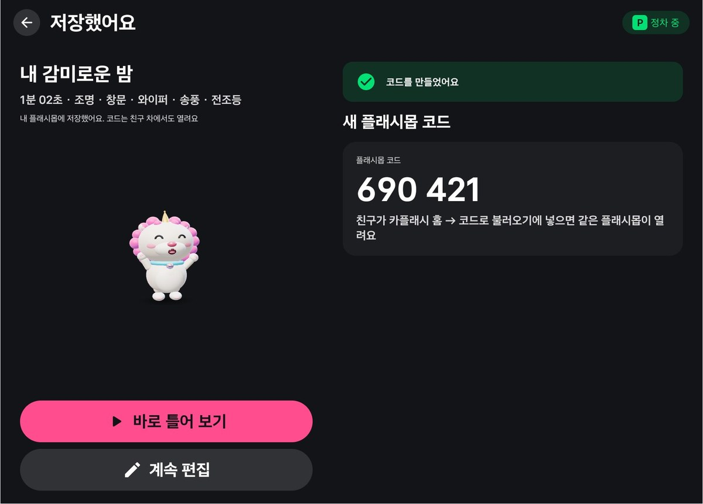
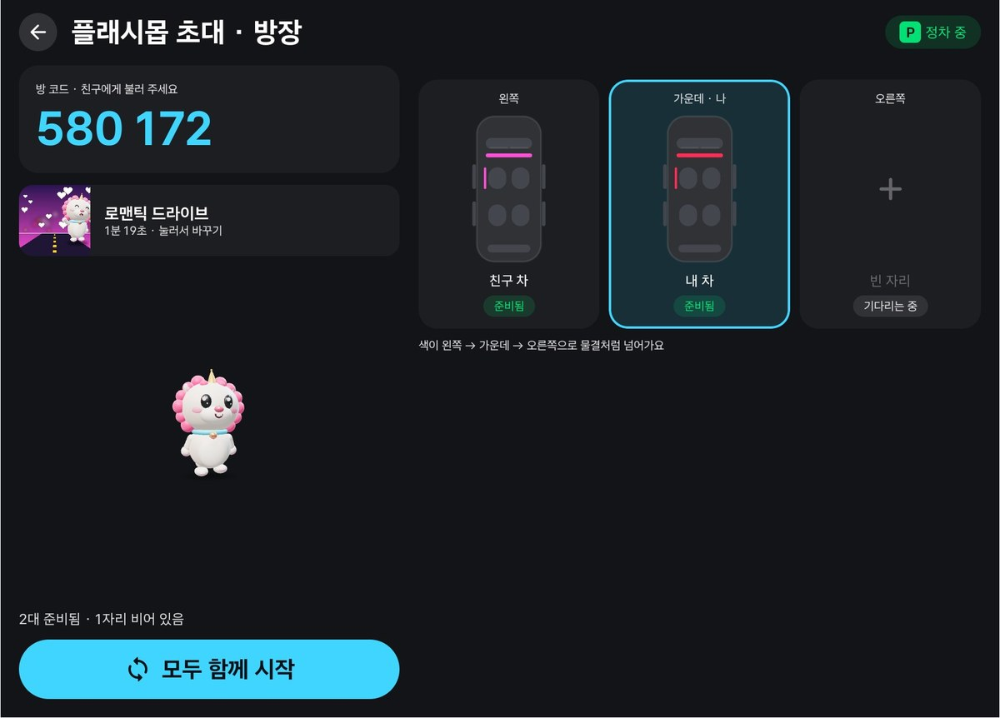
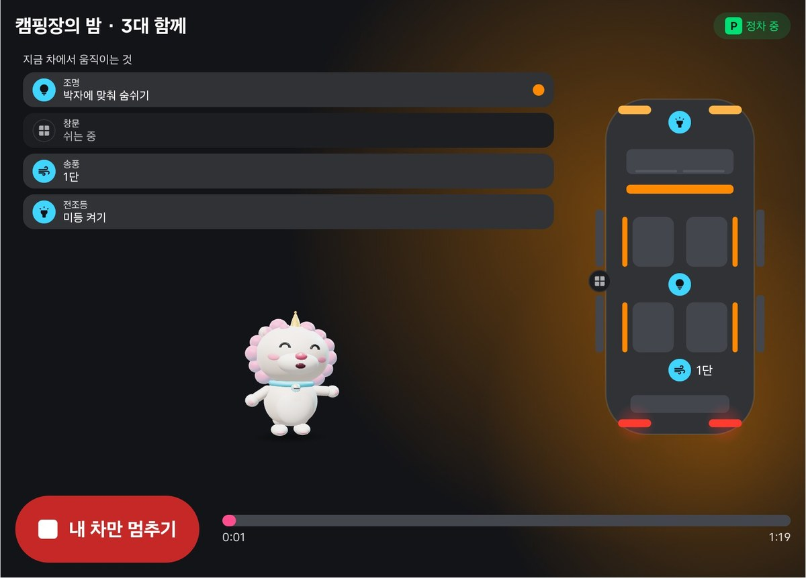

# 카플래시 CarFlash

**정차 중인 내 차가 노래 한 곡에 맞춰 실내 조명, 창문, 와이퍼, 송풍, 전조등까지 함께 움직이는 자동차 플래시몹 앱.** 만든 플래시몹은 6자리 코드로 나누고, 여러 대가 한 신호로 동시에 시작합니다.

현대자동차그룹 차량용 앱 개발 공모전(Pleos Connect) 출품작 · 팀 Haechi



## 시연 영상

[](docs/media/carflash-demo.mp4)

**[전체 시연 영상 보기 (약 1분, mp4)](docs/media/carflash-demo.mp4)**

Pleos Connect 에뮬레이터에서 실제로 실행한 화면입니다. 왼쪽 아래는 버추얼 콘솔의 차량 신호(기어, 실내 조명, 창문 등)로, 앱이 차를 실제로 움직이는지 함께 보여 줍니다. 속도를 바꾸지 않았고, 기다리는 구간만 잘라 냈습니다.

1. **시작** — 홈에서 「캠핑장의 밤」을 고르고, 준비 화면에서 3·2·1 카운트다운
2. **재생** — 박자에 맞춰 실내 조명·송풍·미등이 움직이고 콘솔 값이 같이 바뀜
3. **안전** — 기어를 D로 바꾸면 바로 멈추고, P로 돌아오면 멈춘 이유와 되돌린 내용을 보여 줌
4. **만들기** — 곡을 고르고 마디마다 조명·창문 블록을 놓아 저장, 6자리 코드
5. **함께** — 방 코드로 다른 차가 들어오고, 모두 같은 순간에 시작

## 빠르게 보기

| | |
|---|---|
| APK | [`apk/Haechi_CarFlash_release.apk`](apk/Haechi_CarFlash_release.apk) — 출시 빌드(R8 축소, 릴리스 서명, 12 MB, v1.0.0) |
| 시험 환경 | Pleos Connect Emulator v2.1.0 (Android API 34, arm64), 버추얼 콘솔 |
| 필요한 설정 | 권한 자동 부여 설치(`-g`), 버추얼 콘솔에서 기어 P |
| 개발 환경 | JDK 17, Android SDK 34, Kotlin + Jetpack Compose |

**실행 3단계**

```bash
# 1. Pleos Connect 에뮬레이터를 Cold boot로 켠다 (Quick boot면 차량 기능이 동작하지 않음)
# 2. APK 설치 (권한 자동 부여)
adb install -r -g apk/Haechi_CarFlash_release.apk
# 3. 버추얼 콘솔에서 기어를 P로 두고, 앱 목록에서 "카플래시" 실행
```

처음 실행하면 안전 약속 화면이 나오고, "알겠어요, 시작"을 누르면 홈입니다. 홈의 "오늘의 플래시몹"을 누르고 준비 화면에서 시작하면, 버추얼 콘솔의 Light·Window·Wiper·HVAC 값이 곡에 맞춰 바뀌는 것을 볼 수 있습니다.

**직접 빌드**

```bash
./gradlew :app:assembleDebug                 # 디버그(시험 옵션 포함)
./gradlew :app:assembleRelease               # 출시(R8). 서명 키가 없으면 디버그 키로 서명됨
adb install -r -g app/build/outputs/apk/debug/app-debug.apk
```

출시 APK는 에뮬레이터 기본 흐름 시험(`python3 e2e/release_smoke.py`)을 통과했습니다: 설치·첫 실행, 해치, 재생 중 차 값 변화, 기어 D 정지·복원, 만들기·코드, 함께 플래시몹, 크래시 없음. 디버그 빌드가 설치돼 있으면 서명이 달라 먼저 지워야 합니다(`adb uninstall app.carflash`).

## 무엇을 하나

| | 기능 | 설명 |
|---|---|---|
| ▶ | 오늘의 플래시몹 | 추천 5곡을 버튼 한 번으로. 시작 전 차에서 일어날 일을 먼저 알려 줌 |
| ✎ | 플래시몹 만들기 | 마디마다 조명 패턴 10종, 창문, 와이퍼, 송풍, 전조등 블록을 탭으로. 실제 차로 미리보기 |
| # | 코드로 나누기 | 6자리 코드. 친구 차에서 같은 플래시몹 재생, 차마다 다른 장치는 자동으로 맞춤 |
| ⇄ | 함께 플래시몹 | 방 코드로 여러 대 참가, 서버 시각 기준 동시 시작, 자리 순서대로 색이 물결처럼 |
| ☺ | 해치 | 곡에 맞춰 춤추는 3D 마스코트 |

### 화면

| | |
|---|---|
|  |  |
| **홈.** 오늘의 플래시몹을 버튼 한 번으로, 코드로 불러오기·초대·만들기 | **준비.** 켜고 끌 효과와 창문 경고를 먼저 보여 줌 |
|  |  |
| **재생.** 지금 움직이는 장치를 왼쪽 목록과 오른쪽 차 그림에 같은 아이콘으로 | **기어 변경으로 멈춤.** 멈춘 위치, 되돌린 내용, 전조등 확인 안내 |
|  |  |
| **만들기.** 마디마다 조명·창문·와이퍼·송풍·전조등 블록을 탭으로 | **저장과 6자리 코드.** 친구 차에서 같은 플래시몹 재생 |
|  |  |
| **함께 플래시몹 대기실.** 자리별 차와 준비 상태 | **세 대가 함께 재생.** 자리 순서대로 빛이 물결처럼 넘어감 |

함께 플래시몹 화면의 다른 차는 앱 안 시험용 서버의 가상 참가자입니다.

## 왜 차에서만 되는가

1. **차가 출력 장치입니다.** 화면이 아니라 조명·창문·와이퍼·바람·전조등이 박자에 맞춰 움직입니다.
2. **주행·정차 맥락과 묶여 있습니다.** P단에서만 시작하고, 기어가 바뀌면 즉시 멈추고 원래대로 되돌립니다.
3. **차 상태를 읽어 연출을 바꿉니다.** 배터리 잔량과 차가 지원하는 장치에 따라 효과를 조절합니다.
4. **차와 차가 함께 공연합니다.** 한 대로는 만들 수 없는 장면입니다.

## 안전 설계와 검증

| 상황 | 동작 | 에뮬레이터 측정 |
|---|---|---|
| 재생 중 기어 D | 즉시 정지, 모든 장치를 시작 전 값으로 | 0.13초 안에 복원, 복원 명령 22 ms |
| 앱이 강제 종료됨 | 다음 실행 때 시작 전 상태로 복원 | 확인 |
| 배터리 20% 미만 / 10% 미만 | 창문·송풍 끔·밝기 70% / 시작 안 함 | 15%·5%·재생 중 8% 각각 확인 |
| 전조등 | P단에서만, 깜빡임 초당 약 1.2회 이하 | D단은 차가 거부, P 복귀 시 0.1초 안에 원래 값 |
| 창문 | 최대 60%, 준비 화면에서 먼저 경고 | 정지 0.3초 안에 닫힘 |
| 오프라인 | 추천·만들기는 그대로, 코드·초대만 끔 | 확인 |

주행 중 사용(DO)을 선언하지 않습니다. 주행 중에는 시스템이 앱 화면을 가리고, 카플래시는 아무것도 움직이지 않습니다.

## Pleos SDK 사용

`ai.pleos.playground:Vehicle:2.3.2`

| 기능 | API | 권한 (`pleos.car.permission.*`) |
|---|---|---|
| 기어 | `getGear`, `registerGearSelection` | `CAR_DRIVE` |
| 실내 조명 | `setAmbientLightBrightnessColor`, `setAmbientLightBrightness` | `CAR_LIGHTS`, `CONTROL_CAR_LIGHTS` |
| 전조등·미등 | `setLowBeamLightSwitch`, `setTailLampLightSwitch` | `CAR_LIGHTS`, `CONTROL_CAR_LIGHTS` |
| 창문 | `setWindowPosition` | `CAR_WINDOWS`, `CONTROL_CAR_WINDOWS` |
| 와이퍼 | `setWiperSwitch` | `READ_WINDSHIELD_WIPERS`, `CONTROL_WINDSHIELD_WIPERS` |
| 송풍 | `setHvacFanSpeed` | `CAR_CLIMATE`, `CONTROL_CAR_CLIMATE` |
| 배터리 | `getEvBattery` | `CAR_ENERGY` |
| 지원 확인 | 장치별 `…Capabilities` 조회 | — |

## 구조

```
app/src/main/java/app/carflash/
├── vehicle/   차량 게이트웨이 (Pleos 구현 · 시험용 가짜 구현)
├── show/      플래시몹 엔진, 타임라인, 포그라운드 서비스
├── data/      플래시몹 저장소, 저장 형식, 코드·초대 서버(현재 앱 안 목업)
├── haechi/    마스코트를 띄우는 WebView 호스트
└── ui/        Compose 화면과 컴포넌트, 테마
app/src/main/assets/
├── haechi/    3D 마스코트 (three.js)
├── songs/     자체 합성 곡 5개
└── covers/    플래시몹 커버
e2e/           에뮬레이터 자동 시험 (adb + 버추얼 콘솔)
tools/         곡·커버 생성 스크립트
docs/          설계 문서, README용 화면과 시연 영상
```

엔진은 곡 재생 위치 하나를 시계로 써서 박자마다 장면을 계산하고, 바뀐 값만 차에 보냅니다. 시작 직전 차 상태를 저장해 두고 끝·정지·기어 변경 때 되돌립니다.

## 시험

에뮬레이터 자동 시험 195개 항목이 모두 통과합니다(2026-11-07).

| 묶음 | 항목 | 내용 |
|---|---|---|
| S1 | 22 | 첫 실행, 홈, 기어 표시, 해치 |
| S2 | 27 | 플래시몹 엔진, 재생, 정지·복원 |
| S3 | 31 | 기어 정지, 멈춘 이유, 배터리, 오프라인 |
| S4 | 34 | 만들기, 저장, 코드 불러오기 |
| S5 | 40 | 함께 플래시몹, 동시 시작, 앱 종료 복원 |
| S6 | 19 + 2 | 세로 분할 화면, 해치 프레임 |
| S7 | 20 | 전조등·미등, 재생 화면 표시 |

```bash
python3 e2e/run_all.py          # 디버그 빌드 전체 회귀. 에뮬레이터와 버추얼 콘솔이 켜져 있어야 함
python3 e2e/release_smoke.py    # 출시 APK 기본 흐름 14항목
```

## 로드맵

- **2차 PT까지:** 코드 공유·함께 플래시몹을 실제 서버로, 휴대폰 웹 미리보기(코드로 가상 차 재생).
- **그 뒤:** 계절·테마 플래시몹 팩, 아티스트·팬덤 공식 플래시몹, 행사용 대량 동기화, 음성으로 시작.

## 알려진 한계

- 차량 제어 권한은 앱 마켓 출시 때 별도 승인이 필요합니다. 앱은 장치마다 지원 여부를 먼저 확인하고 되는 것만 씁니다.
- 전조등 스위치가 AUTO였다면 앱이 AUTO로 되돌릴 수 없습니다. 끝 화면에서 직접 맞추라고 알립니다.
- 코드 공유·함께 플래시몹 서버는 지금 앱 안 목업입니다. 실제 여러 차 사이의 동시 시작 오차는 아직 재지 않았습니다.
- 에뮬레이터에서는 화면 녹화 중 프레임이 다소 떨어집니다. 시연 영상의 끊김은 녹화 환경 탓이며 실차 성능과는 다릅니다.

## 라이선스와 출처

- 글꼴: Asta Sans — SIL Open Font License 1.1 ([`docs/AstaSans-OFL.txt`](docs/AstaSans-OFL.txt))
- 3D: three.js — MIT License (`app/src/main/assets/haechi/lib/three.module.js` 머리에 고지 포함. `RoomEnvironment.js`도 three.js 예제 모듈)
- 곡 5개, 커버, 마스코트 해치: 팀이 직접 만들었습니다(`tools/make_songs.py`로 수식 합성, `tools/make_covers.py`).
- Pleos Playground Vehicle SDK: Pleos 개발자 약관에 따라 사용.
